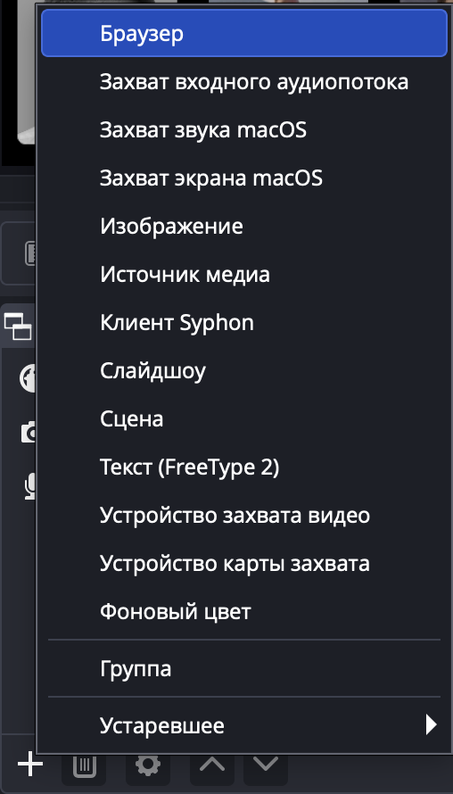
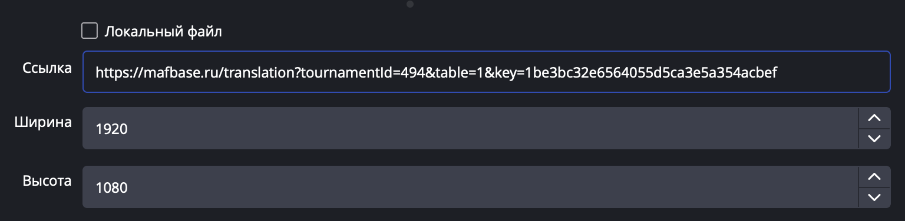
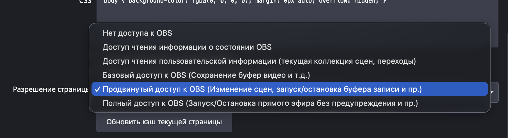
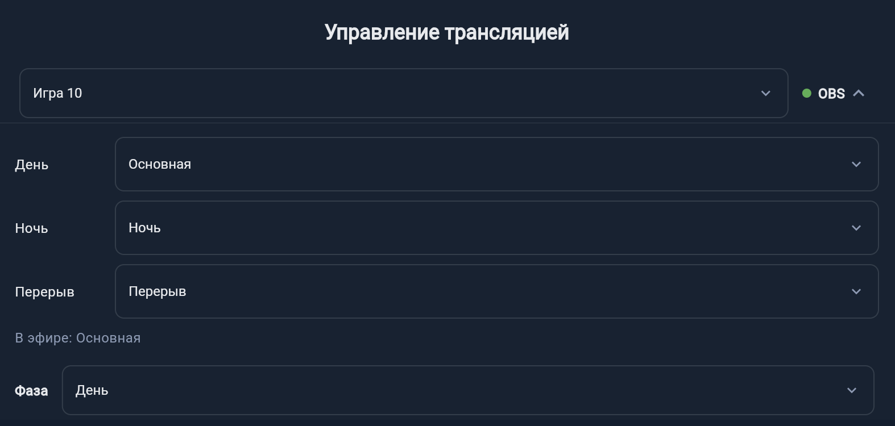

# Пользовательские флоу: Турнир

---

## Флоу 1: Плашки (OBS-виджеты для трансляции)

Полный путь организатора турнира от создания турнира до управления плашками во время стрима через OBS. Те же плашки работают и в трансляции с телефона — см. [Флоу 5: Трансляция с телефона](#флоу-5-трансляция-с-телефона).

### Предусловия

- Пользователь авторизован в приложении

### Шаги

**1. Создание турнира**

1. Пользователь открывает список турниров (`/tournament`)
2. Нажимает кнопку «+» (FAB) для создания нового турнира
3. Турнир создаётся, пользователь попадает на страницу турнира (`/tournament/:id`)

**2. Добавление игроков**

4. В боковом меню (секция «Основное») пользователь нажимает «Добавить игрока»
5. Открывается диалог добавления игрока — пользователь вводит данные
6. Повторяет, пока все участники не добавлены

**3. Настройка турнира**

7. В боковом меню (секция «Управление») пользователь нажимает «Настройки»
8. На странице настроек (`/tournament/:id/settings`) задаёт:
   - Количество основных игр
   - Количество швейцарских игр (если нужно)
   - Количество финальных игр
   - Схему рейтинга
9. Нажимает «Сохранить»

**4. Оплата плашек**

10. В боковом меню (секция «Управление») пользователь нажимает «Оплата»
11. Открывается диалог оплаты с двумя параметрами:
    - **Количество игроков** — кратно 10, можно увеличить/уменьшить кнопками «+»/«−»
    - **Плашки** — чекбокс для включения плашек: они работают и в OBS, и в трансляции с телефона
12. Пользователь ставит галочку «Плашки»
13. Отображается итоговая стоимость:
    - 10 игроков без плашек — бесплатно
    - 10 игроков + плашки — 300₽
    - 20+ игроков — 300₽ за каждые 10 без плашек, 400₽ за каждые 10 с плашками
14. Нажимает «Оплатить»
15. После успешной оплаты пункт «Плашки для трансляции» в боковом меню (секция «Функции») становится доступным. До оплаты он виден с замком и подписью «Доступно после оплаты»: по нажатию открывается пояснение с кнопкой «Оплатить», а диалог оплаты открывается с уже отмеченными плашками

**5. Генерация или импорт рассадки**

> **Важно:** Без рассадки плашки будут пустыми — OBS-виджет не знает, какие игроки сидят за столом.

16. Пользователь переходит на страницу рассадки: в боковом меню (секция «Основное») нажимает «Рассадка»
17. Открывается страница рассадки (`/tournament/:id/editSeating`)
18. Пользователь выбирает один из способов:
    - **Генерация в Mafbase** — нажимает «Сгенерировать» для автоматической рассадки на основе добавленных игроков
    - **Импорт из GoMafia** — нажимает «Загрузить с Gomafia» и следует шагам из [Флоу 3: Импорт рассадки из GoMafia](#флоу-3-импорт-рассадки-из-gomafia)
19. После применения рассадки игроки распределены по столам, можно переходить к настройке плашек

**6. Получение ссылок для OBS**

20. В боковом меню пользователь раскрывает пункт «Плашки для трансляции» (иконка слоёв)
21. Открывается панель с параметрами:
    - **Дизайн** — кнопка выбора визуального оформления плашек
    - **Скопировать ссылки для всех столов** — кнопка копирования; неактивна, пока в турнире меньше 10 участников
    - **Ссылки по столам** — у каждого стола «Управление» и «Ссылка для OBS». Страницу управления «Открыть» показывает сразу: в приложении внутри него, в браузере в новой вкладке. Ссылку для OBS можно скопировать, а в приложении ещё и отправить через «Поделиться». Если столов больше 4, список свёрнут под заголовком «Ссылки по столам»

    Если рассадки ещё нет, над кнопками показано предупреждение «Без рассадки плашки будут пустыми» и кнопка «К рассадке»

**6а. Выбор дизайна (опционально)**

22. Нажимает на кнопку дизайна (по умолчанию — «mafbase»)
23. Открывается диалог выбора дизайна с превью каждого варианта
24. Выбирает понравившийся дизайн, нажимает «Выбрать»
25. Дизайн применяется, ссылки обновляются

**6б. Копирование ссылок**

26. Нажимает «Скопировать ссылки для всех столов»
27. В буфер обмена копируется текст со ссылками для каждого стола:
    ```
    Стол 1:
    Ссылка для встраивания в обс: https://mafbase.ru/translation?tournamentId=...&table=1&key=...&design=...
    Ссылка для управления: https://mafbase.ru/translationControl?tournamentId=...&table=1&key=...&design=...

    Стол 2:
    ...
    ```
    Количество столов = количество игроков ÷ 10
28. Появляется снэкбар «Ссылки скопированы»

**7. Настройка OBS**

29. Пользователь открывает OBS Studio
30. В панели «Источники» нажимает «+» и выбирает «Браузер» (Browser)

    

31. В свойствах источника в полях «Ширина» и «Высота» выставляет **1920** и **1080** — плашки рассчитаны на этот размер. Если ширина источника не больше 1000 или высота не больше 600 (например, 800×600 по умолчанию), виджет покажет предупреждение
32. В поле «Ссылка» (URL) вставляет **ссылку для встраивания** (`/translation?...`) — это виджет, который видят зрители

    

33. Если нужно автопереключение сцен по фазе игры (см. 8в, шаги 43–47), в поле «Разрешение страницы» (Page permissions) выбирает **«Продвинутый доступ к OBS»** — уровень, на котором странице разрешено переключать сцены (в английском интерфейсе — «Advanced access to OBS»). «Полный доступ к OBS» тоже подходит, с более низкими правами сцены не переключаются

    

34. **Не включает** в свойствах источника «Отключать источник, когда не видим» (Shutdown source when not visible). Иначе, когда эфир уйдёт на сцену без виджета, источник выключится, и OBS уже не переключится обратно. На странице управления это видно как статус «Не подключён» в блоке OBS
35. Настраивает положение виджета на сцене

Те же шаги со скриншотами есть в чеклисте организатора, в листе пункта «Виджет добавлен в OBS» (см. [Флоу 4](#флоу-4-чеклист-организатора)).

**8. Управление плашками во время игры**

Плашки можно использовать в двух режимах:

**8а. С ручным управлением**

36. Пользователь открывает **ссылку для управления** (`/translationControl?...`) в браузере
37. На странице управления:
    - **Выбор игры** — dropdown с номером текущей игры (от 1 до максимума)
    - **Фаза** — день, ночь или перерыв
    - **OBS** — кнопка со статусом OBS справа от выбора игры, раскрывает выбор сцен для каждой фазы (см. 8в)
    - **Список из 10 игроков** — для каждого игрока отображается:
      - Номер места (1–10)
      - **Роль** — переключатель роли (мирный, мафия, шериф, дон)
      - **Статус** — переключатель статуса (живой, убит, удалён и т.д.)
38. При выборе другой игры — данные обновляются автоматически
39. При изменении роли или статуса — изменения мгновенно отражаются на виджете в OBS через WebSocket-соединение

**8б. Без ручного управления**

40. Плашки можно использовать без открытия страницы управления
41. При отправке уведомления о начале следующей игры (см. [Флоу 2, шаг 6а](#флоу-2-уведомления-игрокам-на-турнире)) плашки автоматически переключаются на соответствующую игру — рассадка обновляется на виджете
42. В этом режиме на плашках отображаются только никнеймы игроков за столом, без ролей и статусов

**8в. Автопереключение сцен OBS по фазе**

43. На странице управления в ряду с выбором игры (если выбора игры нет — в ряду с переключателем фазы) находится кнопка **OBS**. Цвет точки на ней показывает статус, на компьютере рядом написан и сам статус:
    - **«Не подключён»** — виджет не открыт в OBS или источник выключен. Подсказка предлагает добавить ссылку для встраивания как источник «Браузер». Уже выбранные сцены показываются только для чтения
    - **«Нет прав на переключение сцен»** — в поле «Разрешение страницы» не выбран «Продвинутый доступ к OBS» (см. шаг 33). Подсказка напоминает, где это настроить: «Откройте свойства источника «Браузер» и в поле «Разрешение страницы» выберите «Продвинутый доступ к OBS» или «Полный доступ к OBS»»
    - **«Подключён»** — можно выбирать сцены
44. Для каждой фазы — «День», «Ночь», «Перерыв» — пользователь выбирает сцену из списка сцен OBS или «Не переключать». Выбор сохраняется сразу и общий для всех, у кого открыта страница управления этого стола
45. Если выбранной сцены больше нет в OBS (её переименовали или удалили), она остаётся в списке с пометкой «(нет в OBS)» — нужно выбрать другую
46. Строка «В эфире: …» показывает сцену, которая сейчас идёт в OBS
47. Нажатие на кнопку OBS раскрывает под этим рядом панель на всю ширину: подсказки, выбор сцен и строку «В эфире». Повторное нажатие сворачивает её. По умолчанию панель свёрнута, чтобы не занимать место над списком игроков; раскрытая панель остаётся открытой, пока её не свернут или не закроют страницу

    

> **Когда переключается сцена:** только в момент смены фазы на странице управления. Перезагрузка источника «Браузер» или повторное открытие виджета сцену не трогает — OBS остаётся на той, что сейчас в эфире. Для фазы с «Не переключать» сцена при смене фазы не меняется.

На странице управления клубной трансляцией кнопка OBS стоит в ряду с переключателем фазы.

### Результат

Зрители трансляции видят в реальном времени виджет с никнеймами игроков за столом. При ручном управлении — также роли и статусы. Плашки переключаются между играми автоматически при отправке уведомления о начале игры или вручную через страницу управления. Если выбраны сцены OBS, при смене фазы OBS сам переключается на нужную сцену.

---

## Флоу 2: Уведомления игрокам на турнире

Полный путь организатора от создания турнира до отправки уведомлений участникам через Telegram и ВКонтакте.

### Каналы доставки уведомлений

Уведомления доставляются игрокам через два канала:

| Канал | Как игрок подключается | Условие получения |
|-------|----------------------|-------------------|
| **Telegram** | Игрок самостоятельно пишет свой ФСМ-ник боту [@mafbase_notification_bot](https://t.me/mafbase_notification_bot) | Игрок должен подписаться на бота и указать свой ФСМ-ник |
| **ВКонтакте** | Автоматически | Профиль ВК игрока должен быть привязан к его профилю GoMafia |

### Предусловия

- Организатор авторизован в приложении
- Турнир оплачен
- Для получения уведомлений игроки должны быть подключены хотя бы к одному каналу (см. таблицу выше)

### Шаги

**1. Создание турнира**

1. Пользователь открывает список турниров (`/tournament`)
2. Нажимает кнопку «+» (FAB) для создания нового турнира
3. Турнир создаётся, пользователь попадает на страницу турнира

**2. Добавление игроков**

4. В боковом меню нажимает «Добавить игрока»
5. Добавляет всех участников турнира

**3. Настройка количества игр**

6. В боковом меню переходит в «Настройки» (`/tournament/:id/settings`)
7. Указывает количество основных игр (например, 6)
8. Нажимает «Сохранить»

> **Важно:** Если количество игр = 0, при попытке отправить оповещение о начале игры отобразится предупреждение: «Укажите количество игр в настройках турнира»

**4. Оплата турнира**

9. В боковом меню нажимает «Оплата»
10. Указывает количество оплачиваемых игроков (кратно 10)
11. Нажимает «Оплатить»

**5. Секция «Оповещения» в меню**

12. До оплаты секция «Оповещения» в боковом меню состоит из одного пункта с замком: он открывает пояснение о каналах доставки и кнопку «Оплатить». После оплаты и при включённых уведомлениях в секции три пункта:
    - **Оповещение о начале игры** (иконка колокольчика)
    - **Отправить текст** (иконка сообщения)
    - **Описания столов** (иконка местоположения)

**6а. Отправка оповещения о начале игры**

13. Пользователь раскрывает пункт «Оповещение о начале игры»
14. Открывается форма с двумя полями:
    - **Время** — кнопка для выбора времени через системный time picker (необязательно)
    - **Номер игры** — dropdown от 1 до максимального номера игры
15. Выбирает номер игры (обязательно) и, при желании, время начала
16. Нажимает «Отправить»
17. Участникам турнира отправляется уведомление о начале указанной игры через Telegram и/или ВК
18. Появляется снэкбар «Оповещение успешно отправлено»
19. Форма автоматически сворачивается

**6б. Отправка произвольного текста**

20. Пользователь раскрывает пункт «Отправить текст»
21. Открывается форма с текстовым полем (до 3 строк)
22. Вводит произвольное сообщение (например: «Перерыв 15 минут», «Сбор у стола 3»)
23. Кнопка «Отправить» становится активной (неактивна при пустом поле)
24. Нажимает «Отправить»
25. Участникам турнира отправляется уведомление с введённым текстом через Telegram и/или ВК
26. Появляется снэкбар «Оповещение успешно отправлено»
27. Форма автоматически сворачивается

**6в. Описания столов**

28. Пользователь нажимает «Описания столов»
29. Открывается страница `/tournament/:id/table-descriptions`
30. Для каждого стола можно указать текстовое описание его расположения (например: «2 этаж, комната у лестницы», «Зал B, левый угол»)
31. Эти описания включаются в уведомления о начале игры — игрок получает не только номер своего стола, но и информацию о том, где этот стол находится

### Типичные сценарии использования

| Сценарий | Тип уведомления | Пример |
|----------|-----------------|--------|
| Начинается 3-я игра в 15:30 | Начало игры | Игра 3, время 15:30 |
| Технический перерыв | Произвольный текст | «Перерыв 20 минут» |
| Смена локации | Произвольный текст | «Переезд в зал B» |
| Объявление результатов | Произвольный текст | «Результаты на стенде у входа» |

### Результат

Участники турнира получают уведомления через Telegram (если подписались на бота) и/или ВКонтакте (если профиль GoMafia связан с ФСМ). Организатор может оперативно информировать игроков о начале игр и любых организационных моментах.

### Подготовка игроков к получению уведомлений

Организатору рекомендуется заранее сообщить участникам:

1. **Telegram**: написать боту [@mafbase_notification_bot](https://t.me/mafbase_notification_bot) свой ФСМ-ник
2. **ВК**: убедиться, что профиль ВК привязан к профилю GoMafia

---

## Флоу 3: Импорт рассадки из GoMafia

Вместо генерации рассадки в Mafbase организатор может загрузить готовую рассадку из GoMafia (gomafia.pro) — стороннего сервиса управления турнирами по мафии.

### Предусловия

- Организатор авторизован в приложении
- Турнир создан и оплачен
- На GoMafia существует турнир с готовой рассадкой

> **Примечание:** Добавлять игроков в турнир заранее **не обязательно**. При импорте рассадки из GoMafia текущий список игроков турнира заменяется — все существующие игроки удаляются и добавляются игроки из импортированной рассадки.

### Шаги

**1. Переход на страницу рассадки**

1. В боковом меню (секция «Основное») пользователь нажимает «Рассадка»
2. Открывается страница рассадки (`/tournament/:id/editSeating`)

**2. Выбор опции «Загрузить с GoMafia»**

3. В меню действий (верхняя панель) пользователь нажимает «Загрузить с Gomafia»
4. Открывается диалог ввода URL турнира на GoMafia. Если в турнире уже есть участники, над полем показано предупреждение «Текущий список участников (N) будет заменён участниками с GoMafia»

**3. Ввод ссылки на турнир GoMafia**

5. Пользователь вводит URL турнира, например: `https://gomafia.pro/tournament/12345`
6. Если у турнира уже была привязана ссылка GoMafia — поле заполнено автоматически
7. Система валидирует формат ссылки (должен соответствовать `https://gomafia.pro/tournament/{id}`)
8. Пользователь подтверждает ввод

**4. Загрузка рассадки и импорт игроков**

9. Система отправляет запрос на сервер с ID турнира GoMafia
10. Сервер загружает рассадку из GoMafia
11. Текущие игроки турнира удаляются и заменяются игроками из рассадки GoMafia
12. Система сопоставляет импортированных игроков по ФСМ-никнеймам

**5а. Все игроки сопоставлены**

13. Если все игроки из рассадки GoMafia успешно сопоставлены по ФСМ-никнеймам:
    - Рассадка и список игроков автоматически применяются
    - Страница рассадки обновляется с новыми данными
    - Импорт завершён

**5б. Некоторые игроки не сопоставлены**

14. Если часть игроков из GoMafia не найдена по никнеймам в системе, открывается диалог сопоставления
15. Для каждого ненайденного игрока система показывает:
    - Текст: «Не найден игрок с никнеймом: {никнейм_с_гомафии}»
    - Подсказка: «Выберите игрока из списка, либо создайте нового»
16. Организатор для каждого ненайденного игрока выбирает одно из действий:
    - **Выбрать существующего** — привязать к существующему игроку в системе (его ФСМ-никнейм обновится для будущих импортов)
    - **Создать нового** — создать нового игрока с никнеймом из GoMafia
17. После сопоставления всех игроков рассадка применяется
18. Страница рассадки обновляется

### Когда использовать

| Сценарий | Рекомендация |
|----------|-------------|
| Турнир проходит в рамках ФСМ | Импорт из GoMafia — организатор обязан вести турнир на GoMafia, Mafbase является дополнением |
| Турнир не связан с ФСМ | Генерация рассадки в Mafbase — всё можно сделать на нашем сервисе |

### Результат

Рассадка из GoMafia загружена в Mafbase, список игроков турнира заменён на игроков из импортированной рассадки. При повторных импортах сопоставление уже не потребуется, так как ФСМ-никнеймы сохранены.

---

## Флоу 4: Чеклист организатора

Чеклист показывает владельцу турнира, что ещё не готово: количество игр, участники, рассадка, оплата, охват оповещений и трансляция с плашками. Пункты отмечаются сами по реальному состоянию турнира, а из каждого пункта можно сразу перейти к нужному действию.

### Предусловия

- Пользователь авторизован и открыл свой турнир — чеклист видит только владелец

### Где находится

- **Пункт меню «Чеклист организатора»** — первый в секции «Основное». Справа прогресс «A/B»: B — нескрытые пункты, A — готовые из них
- **Страница** `/tournament/:id/checklist` — пункты по группам «Подготовка», «Оповещения» и «Трансляция»
- **Баннер над списком участников** — «Готовность турнира A/B» и «Дальше: …» с первым неготовым пунктом. Кнопка «Открыть» ведёт на страницу чеклиста, а если следующий пункт ждёт оплаты — вместо неё «Оплатить». Баннер исчезает, когда всё готово. Его можно закрыть крестиком, и в этом турнире он больше не появится

### Шаги

**1. Пункты и статусы**

1. Пользователь открывает «Чеклист организатора»
2. У каждого пункта иконка статуса и подпись: готово, не сделано, есть замечание (например, участников не кратно 10), «Доступно после оплаты» или «Не удалось проверить», если сервис оповещений не ответил
3. Пункты отмечаются сами: чеклист перезагружается при переходах между экранами турнира, после изменений турнира и после закрытия листа пункта

**2. Лист пункта**

4. Нажатие на пункт открывает лист с полной справкой: что это и зачем, шаги, для OBS — скриншоты. По нажатию скриншот открывается на весь экран, его можно увеличить
5. Внизу листа:
   - **«Сделать»** — переход к нужному действию: настройки турнира, диалог «Добавить участника», страница рассадки (в турнире ФСМ — сразу с диалогом загрузки с GoMafia), страница охвата, описания локаций, «Трансляции». У пункта сцен OBS — страница управления стола 1
   - **«Оплатить»** — у пунктов, которые ждут оплаты. У пунктов трансляции окно оплаты открывается с уже отмеченными плашками
   - **«Не нужно»** — скрыть пункт. У охвата оповещений кнопка называется «Достаточно»
   - **«Задать вопрос»** — переход в ВКонтакте (vk.ru/strelas70)
6. У пункта «Виджет добавлен в OBS» вместо «Сделать» прямо в листе ссылки для OBS по столам и выбор дизайна, у пункта «Способ трансляции» — выбор способа

**3. Скрытие пунктов**

7. Своей кнопкой в листе скрываются оплата, охват оповещений, описания столов и автопереключение сцен. Остальные пункты трансляции скрываются выбором способа или вместе с группой
8. Всю группу «Трансляция» скрывает кнопка «Не нужна» рядом с её заголовком
9. Скрытые пункты собраны внизу страницы в свёрнутом блоке «Скрытые (N)», каждый возвращается кнопкой «Вернуть». Скрытая целиком группа «Трансляция» возвращается одной строкой
10. Скрытые пункты в прогресс не входят

**4. Способ трансляции**

11. Пока способ не выбран, в группе «Трансляция» пункты обоих способов идут под подзаголовками «Через OBS на компьютере» и «С телефона через приложение Mafbase»
12. В листе пункта «Способ трансляции» пользователь выбирает «С компьютера через OBS» или «С телефона через приложение Mafbase». Пункты другого способа скрываются, пункты выбранного возвращаются. Выбор можно поменять в том же листе
13. Если одни столы транслируются через OBS, а другие с телефона, способ не выбирают — видны пункты обоих способов

**5. Мастер при создании турнира**

14. После создания турнира поверх его страницы открывается мастер из двух вопросов:
    - «Турнир проходит на GoMafia (ФСМ)?» — при ответе «Да» пользователь вставляет ссылку на турнир на gomafia.pro и нажимает «Сохранить», ссылка сохраняется в турнире
    - «Будете вести трансляцию с плашками?» — «Да, с компьютера через OBS» и «Да, с телефона через приложение Mafbase» выбирают способ трансляции, «Нет» скрывает группу «Трансляция», «Пока не знаю» ничего не меняет
15. В конце — «Открыть чеклист», а в турнире ФСМ ещё «Загрузить участников и рассадку с GoMafia»
16. Мастер можно закрыть на любом шаге: данные ответы сохраняются

**6. Страница охвата оповещений**

17. Пункт «Игроки получат оповещения» ведёт на страницу `/tournament/:id/notification-coverage`
18. На странице:
    - «Получат оповещения: X из N» и разбивка по каналам: Telegram, ВКонтакте (только в турнире ФСМ) и push в приложении — справочно, в общий счёт он не входит
    - в турнире ФСМ — плашка «Участники с ФСМ-ником получат оповещения в ВК автоматически»
    - «Приглашение для чата турнира» с кнопкой «Скопировать приглашение»: текст объясняет, как подписаться на бота по ФСМ-нику или командой /pair
    - список «Не получат оповещения (N)» с причиной у каждого игрока: «Нет ФСМ-ника — оповещение в ВК не придёт» с кнопкой «Указать ФСМ-ник» или «Не подписан на бота в Telegram»
19. В формах «Оповещение об игре» и «Текстовое оповещение» в меню показана строка «Получат: X из N» со ссылкой на эту страницу

### Результат

Организатор видит, что ещё осталось сделать к турниру, понимает, зачем нужен каждый шаг, и из пункта сразу переходит к нужному экрану.

---

## Флоу 5: Трансляция с телефона

Трансляцию с плашками можно вести без компьютера и OBS. Телефон на штативе над столом с приложением Mafbase снимает стол, накладывает плашки и отправляет видео в сервис трансляций, например в VK Видео.

### Предусловия

- Организатор авторизован и открыл свой турнир
- Плашки оплачены — без оплаты видео пойдёт без плашек (см. [Флоу 1, шаги 10–15](#флоу-1-плашки-obs-виджеты-для-трансляции))
- Есть рассадка — без неё плашки пустые
- У оператора телефон с приложением Mafbase: [App Store](https://apps.apple.com/ru/app/mafbase/id6593686225), [RuStore](https://www.rustore.ru/catalog/app/ru.mafbase.app)

### Шаги

**1. Трансляция в сервисе трансляций**

1. Организатор создаёт трансляцию в VK Видео или другом сервисе так же, как для OBS, и получает адрес RTMP-сервера, ключ и ссылку для зрителей

**2. Трансляция стола в Mafbase**

2. В боковом меню (секция «Управление») организатор открывает «Трансляции» (`/tournament/:id/streams`)
3. Сверху блок «Как вести трансляцию с телефона» из трёх шагов, «Подробнее» открывает полную справку. Пока трансляций нет, блок развёрнут. Если плашки не оплачены, ниже строка «Без оплаты плашек видео пойдёт без плашек» и кнопка «Оплатить»
4. Нажимает «Добавить свою ссылку» и заполняет «Номер стола», «Ссылка на трансляцию» (ссылка для зрителей), «RTMP сервер» и «RTMP ключ»
5. Нажимает «Добавить» — у стола появляется трансляция с кнопкой «Ссылка оператора». Если RTMP-сервер или ключ не указаны, вместо ссылки оператора показана подсказка: «Для трансляции с телефона добавьте трансляцию этого стола с RTMP-сервером и ключом»

**3а. Оператор со своим телефоном**

6. Организатор нажимает «Ссылка оператора» — ссылка копируется, снэкбар напоминает: «Ссылка скопирована. Оператору нужно открыть её на телефоне с приложением Mafbase». В приложении рядом есть кнопка «Поделиться»
7. Отправляет ссылку оператору
8. Оператор ставит приложение Mafbase, открывает ссылку на телефоне — она открывается в приложении — и разрешает доступ к камере и микрофону
9. Открывается экран трансляции, всегда в горизонтальной ориентации. Оператор ставит телефон на штатив над столом, подключает зарядку и Wi-Fi и нажимает «Стрим»: трансляция начинается, а кнопка сменяется на «Стоп»
10. Кнопка «Запись» отдельно сохраняет видео в галерею телефона. «Закрыть» во время трансляции или записи спрашивает «Остановить трансляцию и запись?»
11. На iPhone нельзя блокировать экран и сворачивать приложение: в фоне iOS видео не передаёт. Экран трансляции напоминает об этом подсказкой

**3б. Со своего телефона**

12. Организатор в приложении Mafbase на странице «Трансляции» нажимает «Начать с этого телефона» у нужного стола — экран трансляции открывается сразу, без копирования ссылки

**4. Если ссылка попала не тому**

13. У трансляции стола организатор нажимает «Перевыпустить ссылку оператора» (значок с круговыми стрелками) и подтверждает. Прежняя ссылка перестаёт работать: по ней откроется «Ссылка устарела. Запросите у организатора новую ссылку оператора.» Новую ссылку организатор отправляет оператору

**5. Управление плашками**

14. Ведущий работает на странице управления стола так же, как в трансляции через OBS (см. [Флоу 1, раздел 8](#флоу-1-плашки-obs-виджеты-для-трансляции)): открывает её в боковом меню — «Плашки для трансляции» → «Открыть» у нужного стола — и меняет фазу, роли и статусы. Без ручного управления плашки переходят на следующую игру, когда отправлено оповещение о её начале

### Ссылка оператора в браузере

Если открыть ссылку оператора в браузере — на компьютере или на телефоне без приложения, — трансляция не запускается. Страница показывает «Трансляция запускается в приложении Mafbase на телефоне», шаги «Установите приложение Mafbase» и «Откройте эту ссылку на телефоне», кнопки App Store и RuStore, «Скопировать ссылку» и совет: если приложение уже установлено, а ссылка открылась во встроенном браузере мессенджера, открыть её в браузере телефона. Такое открытие не отмечает в чеклисте, что оператор открыл ссылку.

### Чеклист

Способ «С телефона через приложение Mafbase» в группе «Трансляция» чеклиста (см. [Флоу 4](#флоу-4-чеклист-организатора)) отслеживают два пункта:
- «Трансляция с телефона настроена» — сколько столов из рассадки получили трансляцию с RTMP-сервером и ключом
- «Оператор открыл ссылку» — по скольким из этих столов ссылку оператора открыли в приложении. Это ещё не значит, что трансляция идёт: её стоит проверить по ссылке для зрителей

### Результат

Зрители смотрят трансляцию по ссылке для зрителей, а плашки накладываются на видео прямо на телефоне. Ведущий меняет роли и статусы на странице управления так же, как в трансляции через OBS.
